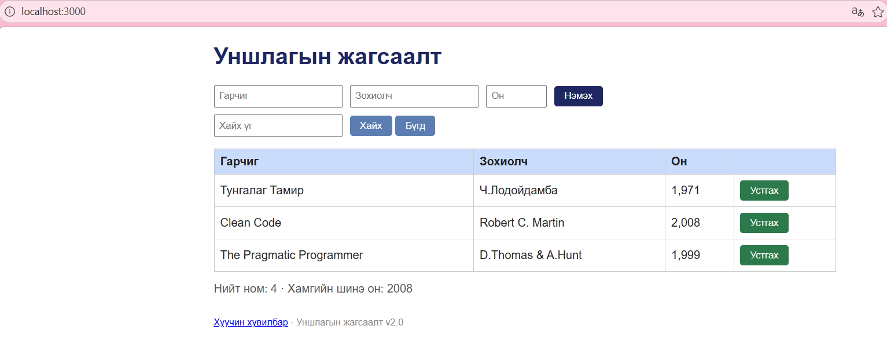

# BUG-01: Анхны 3 номтой хүснэгтийн нийт тоолуур 4 гэж харуулдаг

## Орчин

- Апп: Уншлагын жагсаалт v2.0
- Сервер: Ubuntu / WSL, Node.js v22.22.1
- Браузер: Microsoft Edge 155.0.4283.45 (64-bit)
- Браузерын үйлдлийн систем: Windows 11 25H2
- Огноо: 2026-10-15

## Урьдчилсан нөхцөл

Ажиллаж буй серверийг Ctrl+C-ээр зогсоож, node app.js командаар шинээр асаасан байна.
Өгөгдөл анхны 3 номтой төлөвт байна.

## Дахин гаргах алхам

1. Браузераар http://localhost:3000 хаягийг нээнэ.
2. Өмнө нь нээлттэй байсан бол хуудсыг шинэчилнэ.
3. Хайлт хийхгүй, ном нэмэхгүй, устгахгүй.
4. Хүснэгтийн номын мөрүүдийг тоолно.
5. Хүснэгтийн доорх «Нийт ном» тоолууртай харьцуулна.

## Хүлээгдэж байсан

Спецификацийн «Нийт ном тоолуур хүснэгтэд буй номын тоотой тэнцүү» дүрмийн дагуу 3 номтой хүснэгтийн тоолуур «Нийт ном: 3» гэж харагдана.

## Бодит үр дүн

Хүснэгтэд Тунгалаг Тамир, Clean Code, The Pragmatic Programmer гэсэн 3 ном байгаа боловч «Нийт ном: 4» гэж харагдсан.
Session-ийн төгсгөлд серверийг дахин асааж шалгахад ижил зөрүү давтагдсан.

## Ноцтой байдал

Minor — үндсэн үйлдлийг хаахгүй боловч хэрэглэгчид номын нийт тоог буруу мэдээлнэ.

## Хавсралт

## Олдсон аялал

Supermodel — хүснэгтийн харагдах өгөгдлийг тоолууртай харьцуулсан.
