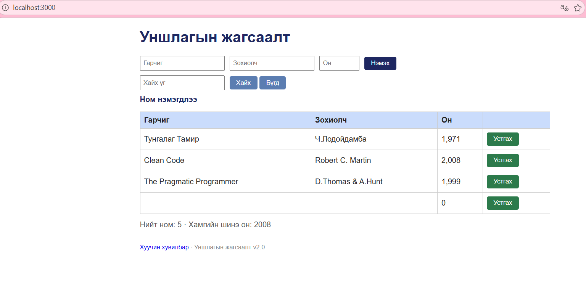

# BUG-05: Хоосон талбаруудтай ном нэмдэг

Орчин: Уншлагын жагсаалт v2.0; Edge 155.0.4283.45;
Windows 11 25H2; Ubuntu/WSL; Node.js v22.22.1.
Огноо: 2026-10-15.

Урьдчилсан нөхцөл: Серверийг Ctrl+C-ээр зогсоож,
node app.js командаар шинээр асаана.
Апп анхны 3 номтой байна.
http://localhost:3000 хаягийг нээж шинэчилнэ.

## Дахин гаргах алхам
1. Гарчиг, Зохиолч, Он талбаруудыг бүгдийг хоосон байлгана.
2. Нэмэх товчийг нэг удаа дарна.
3. Мессеж болон хүснэгтийн шинэ мөрийг шалгана.

Хүлээгдэж байсан: Спецификацийн дагуу гурван талбар
заавал бөглөгдөнө. Дутуу бол ном нэмэгдэхгүй,
ойлгомжтой алдааны мессеж харагдана.

Бодит үр дүн: Гарчиг, зохиолч хоосон, он 0 гэсэн мөр
нэмэгдэж, Ном нэмэгдлээ мессеж харагдсан.

Ноцтой байдал: Major — шаардлагатай өгөгдөлгүй ном хадгалдаг.

## Хавсралт

Олдсон аялал: Supermodel аяллын үеийн оролтын шалгалт.
