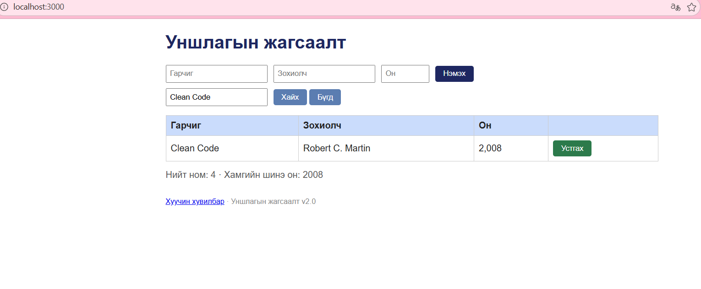
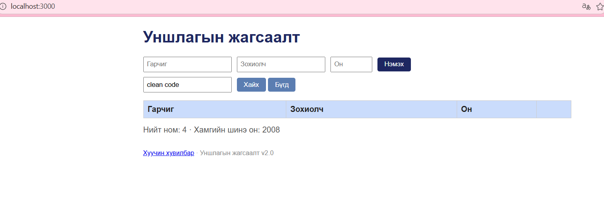

# BUG-06: Гарчгийн хайлт том жижиг үсэг ялгадаг

Орчин: Уншлагын жагсаалт v2.0; Edge 155.0.4283.45;
Windows 11 25H2; Ubuntu/WSL; Node.js v22.22.1.
Огноо: 2026-10-15.

Урьдчилсан нөхцөл: Серверийг Ctrl+C-ээр зогсоож,
node app.js командаар шинээр асаана.
Апп анхны 3 номтой байна.
http://localhost:3000 хаягийг нээж шинэчилнэ.

## Дахин гаргах алхам
1. Хайх үг талбарт Clean Code оруулж Хайх товч дарна.
2. Clean Code ном гарсныг шалгана.
3. Хайлтын утгыг бүрэн арилгаж clean code гэж оруулна.
4. Хайх товч дарж үр дүнг харьцуулна.

Хүлээгдэж байсан: Спецификацийн дагуу хайлт том жижиг
үсэг ялгахгүй. Хоёр хайлт хоёулаа Clean Code номыг олно.

Бодит үр дүн: Clean Code гэж хайхад нэг ном гарсан,
clean code гэж хайхад хүснэгт хоосон болсон.

Ноцтой байдал: Major — үсгийн хэмжээнээс шалтгаалан
жагсаалтад байгаа ном олдохгүй.

## Хавсралт

Олдсон аялал: Supermodel аяллын үеийн хайлтын шалгалт.
