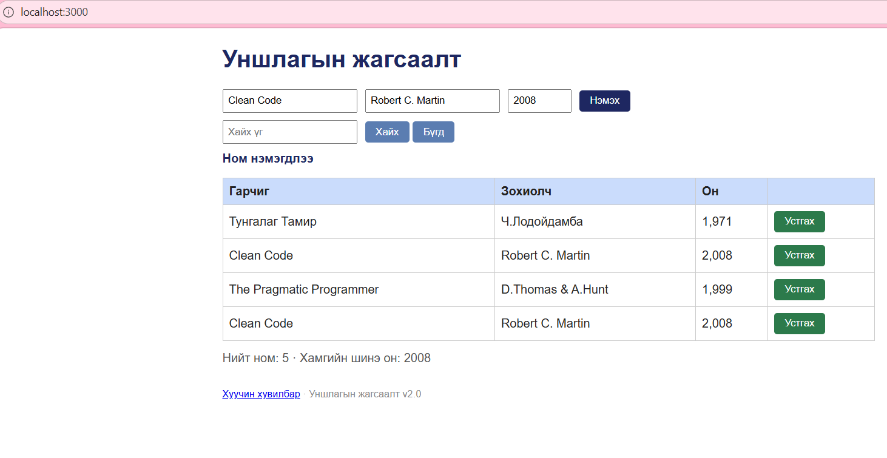

# BUG-07: Ижил гарчиг зохиолчтой номыг давхар нэмдэг

Орчин: Уншлагын жагсаалт v2.0; Edge 155.0.4283.45;
Windows 11 25H2; Ubuntu/WSL; Node.js v22.22.1.
Огноо: 2026-10-15.

Урьдчилсан нөхцөл: Серверийг Ctrl+C-ээр зогсоож,
node app.js командаар шинээр асаана.
Апп анхны 3 номтой байна.
http://localhost:3000 хаягийг нээж шинэчилнэ.

## Дахин гаргах алхам
1. Анхны жагсаалтад Clean Code ном байгааг шалгана.
2. Гарчиг талбарт Clean Code гэж оруулна.
3. Зохиолч талбарт Robert C. Martin гэж оруулна.
4. Он талбарт 2008 гэж оруулна.
5. Нэмэх товчийг нэг удаа дарна.
6. Clean Code нэртэй мөрүүдийг харьцуулна.

Хүлээгдэж байсан: Спецификацийн дагуу ижил гарчиг,
зохиолчтой ном давхар нэмэгдэхгүй.

Бодит үр дүн: Clean Code, Robert C. Martin, 2008 гэсэн
ижил ном хоёр мөр болсон.

Ноцтой байдал: Major — давхардлыг хориглох шаардлага
зөрчигдөж, ижил өгөгдөл дахин хадгалагдана.

## Хавсралт

Олдсон аялал: Supermodel аяллын үеийн өгөгдлийн шалгалт.
