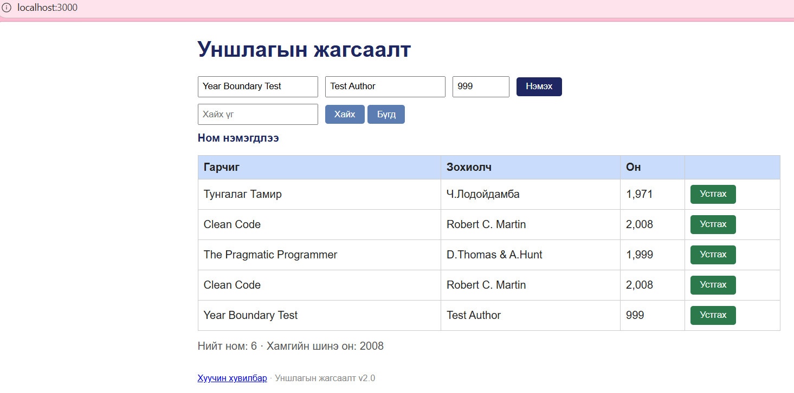
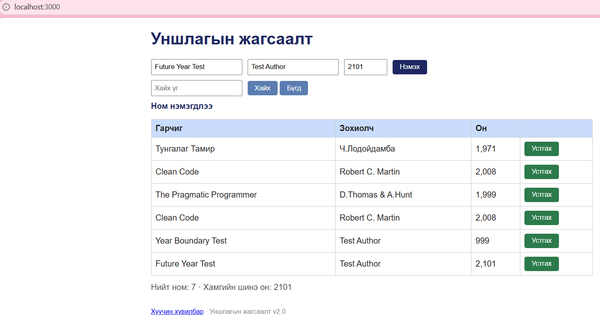
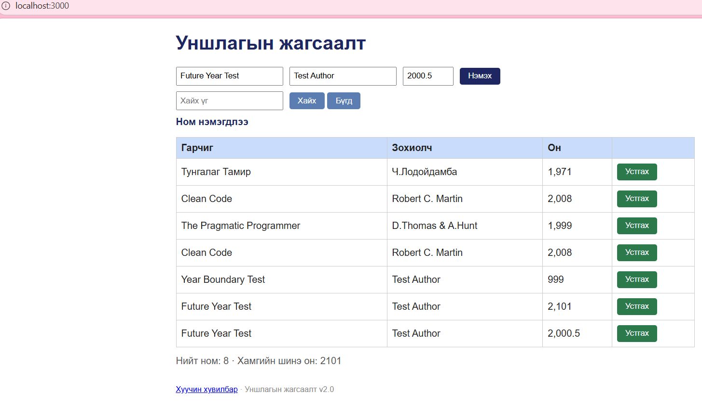

# BUG-08: Хүрээнээс гадуурх болон бутархай оныг зөвшөөрдөг

Орчин: Уншлагын жагсаалт v2.0; Edge 155.0.4283.45;
Windows 11 25H2; Ubuntu/WSL; Node.js v22.22.1.
Огноо: 2026-10-15.

Урьдчилсан нөхцөл: Серверийг Ctrl+C-ээр зогсоож,
node app.js командаар шинээр асаана.
Апп анхны 3 номтой байна.
http://localhost:3000 хаягийг нээж шинэчилнэ.

## Дахин гаргах алхам
1. Гарчигт Year Boundary Test, зохиолчид Test Author,
   онд 999 оруулж Нэмэх товчийг нэг удаа дарна.
2. Талбаруудыг Future Year Test, Test Author, 2101
   болгон сольж Нэмэх товчийг нэг удаа дарна.
3. Future Year Test, Test Author хэвээр байлгаж,
   оныг 2000.5 болгон Нэмэх товчийг нэг удаа дарна.
4. Нэмэгдсэн мөрүүдийн оныг шалгана.

Хүлээгдэж байсан: Спецификацийн дагуу он 1000–2100
хоорондох бүхэл тоо байна. Гурван оролтыг бүгдийг
хориглож, ном нэмэхгүй.

Бодит үр дүн: Гурван оролтоор бүгдээр нь ном нэмэгдсэн.
Бутархай он 2,000.5 гэж харагдсан.
Оны шалгалтын эдгээр хувилбарыг нэг тайланд нэгтгэв.

Ноцтой байдал: Major — хүчингүй онтой өгөгдөл хадгалдаг.

## Хавсралт

Олдсон аялал: Supermodel аяллын үеийн хилийн шалгалт.
