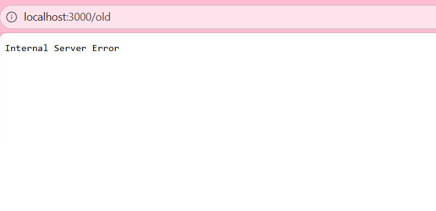

# BUG-09: Хуучин хувилбар холбоос HTTP 500 алдаа буцаадаг

Орчин: Уншлагын жагсаалт v2.0; Edge 155.0.4283.45;
Windows 11 25H2; Ubuntu/WSL; Node.js v22.22.1.
Огноо: 2026-10-15.

Урьдчилсан нөхцөл: Серверийг Ctrl+C-ээр зогсоож,
node app.js командаар шинээр асаана.
Апп анхны 3 номтой байна.
http://localhost:3000 хаягийг нээж шинэчилнэ.

## Дахин гаргах алхам
1. Үндсэн хуудасны доорх Хуучин хувилбар холбоосыг дарна.
2. Нээгдсэн хаяг болон мессежийг шалгана.
3. Ubuntu-ийн хоёр дахь терминалд дараахыг ажиллуулна:

    curl -i --max-time 15 http://localhost:3000/old

Хүлээгдэж байсан: Спецификацийн дагуу бүх хуудас,
холбоос ажиллана. Холбоос ажилладаг хуудас нээнэ.

Бодит үр дүн: /old хуудас Internal Server Error гэж
харуулсан. curl хүсэлт HTTP/1.1 500 Internal Server Error
буцаасан.

Ноцтой байдал: Major — холбоосоор заасан хуудас ашиглах
боломжгүй.

## Хавсралт

[HTTP гаралт](../evidence/bug-09-curl.txt)

Олдсон аялал: Supermodel; Saboteur аргаар HTTP статусыг
нэмэлтээр шалгасан.
