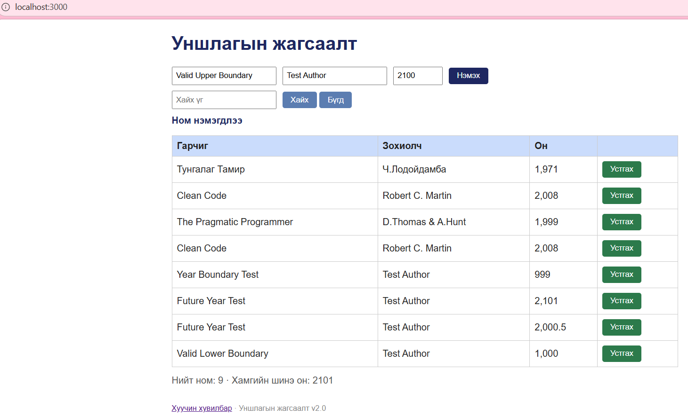

# BUG-10: Устгасны дараа Ном нэмэгдлээ мессеж хэвээр үлддэг

Орчин: Уншлагын жагсаалт v2.0; Edge 155.0.4283.45;
Windows 11 25H2; Ubuntu/WSL; Node.js v22.22.1.
Огноо: 2026-10-15.

Урьдчилсан нөхцөл: Серверийг Ctrl+C-ээр зогсоож,
node app.js командаар шинээр асаана.
Апп анхны 3 номтой байна.
http://localhost:3000 хаягийг нээж шинэчилнэ.

## Дахин гаргах алхам
1. Гарчигт Valid Upper Boundary гэж оруулна.
2. Зохиолчид Test Author, онд 2100 оруулна.
3. Нэмэх товчийг нэг удаа дарна.
4. Нэмэгдсэн Valid Upper Boundary мөрийн Устгах
   товчийг нэг удаа дарна.
5. Мөр арилсан эсэх болон мессежийг шалгана.

Хүлээгдэж байсан: Спецификацийн дагуу үйлдэл бүрийн
дараах мессеж тухайн үйлдэлдээ тохирно.
Устгасны дараа устгах үйлдэлд тохирсон мессеж харуулна.

Бодит үр дүн: Мөр арилсан боловч Ном нэмэгдлээ
мессеж хэвээр харагдсан.

Ноцтой байдал: Minor — гүйцэтгэсэн үйлдлийг буруу мэдээлнэ.

## Хавсралт

Олдсон аялал: Supermodel.
