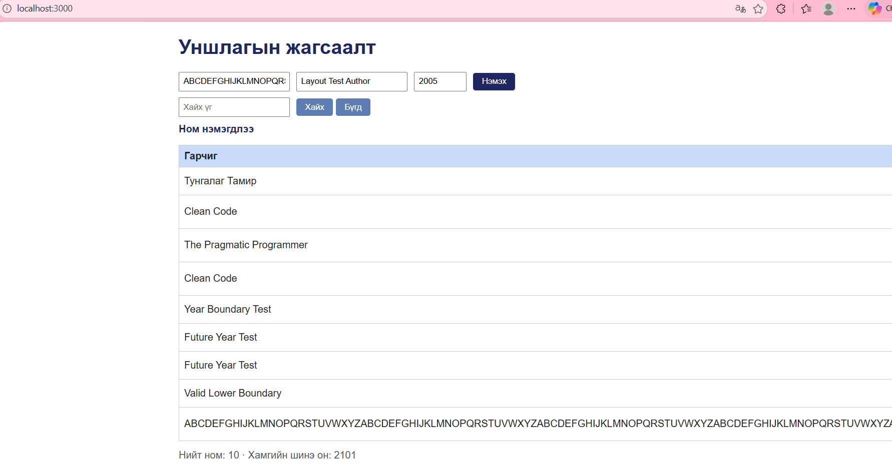

# BUG-11: Зайгүй урт гарчиг хүснэгтийг баруун тийш сунгадаг

Орчин: Уншлагын жагсаалт v2.0; Edge 155.0.4283.45;
Windows 11 25H2; Ubuntu/WSL; Node.js v22.22.1.
Огноо: 2026-10-15.

Урьдчилсан нөхцөл: Серверийг Ctrl+C-ээр зогсоож,
node app.js командаар шинээр асаана.
Апп анхны 3 номтой байна.
http://localhost:3000 хаягийг нээж шинэчилнэ.

## Дахин гаргах алхам
1. Edge цонхыг дэлгэц дүүргэж, zoom-ийг 100% болгоно.
2. Гарчигт доорх зайгүй 260 тэмдэгтийг оруулна:

ABCDEFGHIJKLMNOPQRSTUVWXYZABCDEFGHIJKLMNOPQRSTUVWXYZABCDEFGHIJKLMNOPQRSTUVWXYZABCDEFGHIJKLMNOPQRSTUVWXYZABCDEFGHIJKLMNOPQRSTUVWXYZABCDEFGHIJKLMNOPQRSTUVWXYZABCDEFGHIJKLMNOPQRSTUVWXYZABCDEFGHIJKLMNOPQRSTUVWXYZABCDEFGHIJKLMNOPQRSTUVWXYZABCDEFGHIJKLMNOPQRSTUVWXYZ

3. Зохиолчид Layout Test Author, онд 2005 оруулна.
4. Нэмэх товчийг нэг удаа дарна.
5. Хүснэгтийн өргөн болон багануудыг ажиглана.

Хүлээгдэж байсан: Спецификацийн дагуу хүснэгт ямар ч
урттай оролтод эвдрэхгүй. Урт бичвэрийг багтаан,
бусад багана ба үйлдлийг ашиглах боломжтой байлгана.

Бодит үр дүн: Гарчиг мөр тасрахгүй сунаж, Зохиолч,
Он, Устгах баганууд дэлгэцээс баруун тийш гарсан.
Хуудасны доор хөндлөн гүйлгэгч үүссэн.

Ноцтой байдал: Minor — бусад багана, үйлдлийг харахад
нэмэлт хөндлөн гүйлгэх шаардлагатай болсон.

## Хавсралт

Олдсон аялал: Supermodel.
